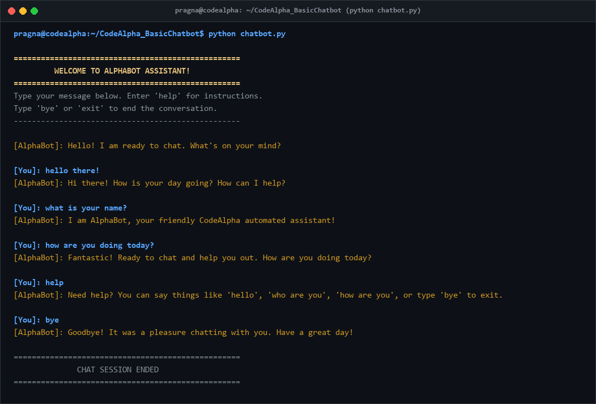

# CodeAlpha Python Programming Internship - Task 4: Basic Chatbot

<div align="center">


</div>

## 📝 Project Overview
This repository contains an interactive, rule-based **Basic Chatbot** CLI named **AlphaBot** developed in Python for the **CodeAlpha Python Programming Internship (Task 4)**. The chatbot understands natural user inputs such as greetings, inquiries regarding its identity and status, requests for guidance, and conversation exit commands, responding dynamically from curated response collections.

---

## 🎯 Task Objectives & Compliance
- [x] **Recognizes Common Inputs**: Handles phrases like `"hello"`, `"how are you"`, `"what is your name"`, `"help"`, and `"bye"`.
- [x] **Predefined Dynamic Responses**: Delivers friendly, randomized replies for each intent (e.g. `"Hi!"`, `"I'm fine, thanks!"`, `"Goodbye!"`).
- [x] **Clean Loop Interaction**: Continuous dialogue loop until the user types `bye` or `exit`.
- [x] **Key Concepts Implemented**: `if-elif` conditional trees, functions, loops, string cleaning/normalization, regex sanitization, input/output.

---

## 📸 Execution Preview
Below is the verified running screenshot of the Basic Chatbot in terminal:

<div align="center">



</div>

---

## ✨ Features
- **Punctuation & Case Normalization**: Strips punctuation characters (`!`, `?`, `.`, `,`) and converts to lowercase so variations like `"Hello!"`, `"HELLO??"`, or `"hey"` match seamlessly.
- **Dynamic Dialogue Variability**: Uses `random.choice` across predefined sentence lists to ensure responses never sound stiff or monotonous.
- **Graceful Fallback Mechanism**: Friendly responses when a query falls outside recognized keywords, guiding the user to valid phrases.
- **Clean Session Termination**: Typing `bye`, `exit`, or pressing `Ctrl+C` cleanly finishes the chat session.

---

## 🛠️ Technologies Used
- **Language**: Python 3.x
- **Standard Libraries**: `re`, `random`, `sys`
- **Dependencies**: None (100% built-in standard library)

---

## 📂 Repository Structure
```text
CodeAlpha_BasicChatbot/
│
├── chatbot.py             # Main Chatbot Script
├── README.md              # Project Documentation & Guide
├── .gitignore             # Git Ignore File
└── screenshots/
    └── run_preview.png    # Terminal Running Screenshot
```

---

## 🚀 How to Run Locally

### Prerequisites
- Python 3.8 or higher installed.
  ```bash
  python --version
  ```

### Step-by-Step Execution
1. **Clone the repository:**
   ```bash
   git clone https://github.com/pragna3101/CodeAlpha_BasicChatbot.git
   ```
2. **Navigate into the directory:**
   ```bash
   cd CodeAlpha_BasicChatbot
   ```
3. **Run the chatbot:**
   ```bash
   python chatbot.py
   ```
4. **Example Interactions:**
   - Type `hello` -> Bot greets you warmly.
   - Type `how are you` -> Bot shares its operational status.
   - Type `what is your name` -> Bot introduces itself as AlphaBot.
   - Type `help` -> Bot shows sample conversational commands.
   - Type `bye` -> Bot closes the session gracefully.

---

## 👤 Author
- **Pragna Zala**
- **GitHub**: [@pragna3101](https://github.com/pragna3101)
- **Internship**: CodeAlpha Python Programming Intern
